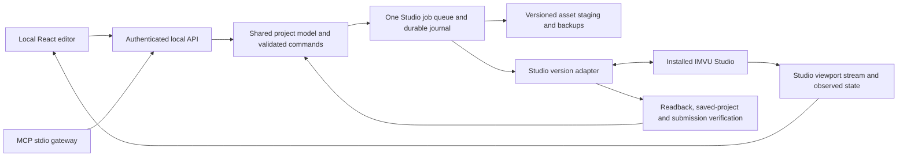
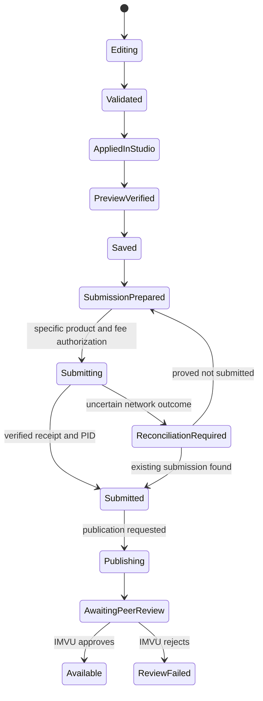

# IMVU Studio companion editor — proposed implementation plan

Status: **planning only; implementation has not started**. Prepared 2026-10-24.
Baseline: repository version 0.1.0, commit `66581c9`; installed Studio 1.44.14.

## 1. Outcome and confirmed scope

Build a simplified visual editor that exposes Studio's authoring options for an
imported mesh/product. A person or an MCP client can make the same changes, see
the actual Studio-rendered result, synchronize the complete project into Studio,
and complete a verified submission. The visual editor and MCP must use the same
validated commands, project state, and job system.

The user confirmed **all Studio settings first; geometry tools later**. Vertex
editing, sculpting, topology changes, UV unwrapping, and weight painting belong to
a later geometry integration. Import/replacement of an already authored mesh,
Studio's own scaling and attachment options, and all relevant product settings
remain in scope now. This project targets Studio even though the broader asset
workspace also uses Legacy Creator.

End-state scope includes every applicable authoring control on the selected
product: meshes, materials/textures, skeleton/attachment settings, scalers,
actions/animations, particles, room/environment settings, product metadata,
images, preview/camera controls, validation, save, and submission. Product-specific
and account-gated options must be inventoried rather than silently omitted.
Editor preferences affecting authoring or preview are included in the inventory.
Account security, purchases unrelated to submission, and IMVU moderation are
external boundaries, not editable product settings.

Submission and publishing are separate workflows. Both are designed below; the
preferred default completion point is still awaiting the user's answer. Until
resolved, the conservative proposed default is verified submission, with
publishing available as a separately selected operation. No upload is authorized
or performed by this planning document.

## 2. What “100% interactable” must mean

We should target **complete, tested authoring parity for a declared Studio version
and capability profile**. We cannot accurately promise universal compatibility
with future Studio changes, every account entitlement, or remote service outcomes.

Create a versioned capability manifest before claiming a coverage percentage.
Each field/action needs: stable internal identifier; visible label; component
identity; product types; account/feature prerequisites; value type; units;
range/options; inherited versus editable state; dependencies; reset/default
semantics; read/write/apply method; persistence rule; and verification tests.

For each applicable field, prove:

1. Read the current effective and locally overridden value.
2. Edit it through the simplified inspector and the MCP command interface.
3. Apply it in Studio and read back the actual resulting value.
4. Preview it when rendering is affected, save it, and verify it after reopening.
5. Reset the override, undo/redo where appropriate, and preserve unrelated data.

Coverage should show separate read, write, reset, persistence, and workflow
results. The denominator is all inventoried applicable controls, including
conditional/advanced ones. A missing adapter is a visible gap; it must not be
excluded to improve the percentage. Feature-gated controls may be unavailable
for one account, but cannot be claimed as tested for other accounts. Inherited
read-only values should be represented correctly, not made falsely editable.

The current server's 17 tools do **not** establish a Studio parity percentage.
Current parity is unmeasured. Its tests cover the existing tools, not all authoring
features. Reaching 100% is a release gate after the manifest and acceptance suite
are complete, not a label for the next incremental milestone.

## 3. The editor experience

Recommended first delivery: a **local web companion on Windows**, launched with
the local service. Keep the UI portable so it can later be packaged as a desktop
application. No public website or hosted account proxy is needed.

- **Left:** project tree for product, meshes, materials, assets, and conditional
  component groups. Select objects by stable identity, not just display names.
- **Center:** the actual Studio viewport, with orbit/pan/zoom, pose/action playback,
  environment selection, and snapshots as those capabilities are verified.
- **Right:** a simplified inspector with plain labels, texture-slot thumbnails,
  color controls, sliders, dropdowns, and conditional help. Advanced expands the
  complete applicable field set. Simplification must not remove capabilities.
- **Bottom:** pending changes, Studio validation messages, conflicts, and job
  progress, with the affected field/object selectable from each message.
- **Top:** Open/Derive, Import, Undo/Redo, Apply to Studio, Save, and Upload.

Show distinct state labels: Edited locally, Applied in Studio, Preview updated,
Saved, and Submitted. A successful file copy or button click cannot mean Uploaded.
Keep technical transport details out of the normal editor flow.

Example: select a material on an imported jacket, replace diffuse/normal/shininess
maps, change transparency/reflection settings, adjust permitted mesh/scaler
options, fill product details, Apply to Studio, inspect the rendered preview,
Save, review upload details/fees, and submit. Report the actual product ID and
verified result. No geometry editing is required for this first workflow.

## 4. Recommended architecture

Use the existing Python implementation as the foundation, with a React/TypeScript
frontend and a single local Python service. The MCP process becomes a thin stdio
gateway into that service. Both clients call the same domain layer; the GUI must
not maintain a separate implementation of editing rules.

The single service owns the Studio session, active project, queue, and transaction
journal. A durable SQLite journal is recommended for project revisions, operation
history, jobs, and submission receipts. Versioned asset files remain on disk.
The existing in-process locks are insufficient when the editor and multiple MCP
processes can all act at once; one session owner and revision checks are required.

The browser-facing API is a separate authenticated loopback API, not the Studio
debug socket. Bind to loopback; require a per-session token, an allowed origin,
and protections for mutating requests. Do not expose a public unauthenticated
control server or pass Studio debugging access directly to frontend code.

### Shared state and synchronization

Maintain three layers: the original/inherited baseline, the user's desired draft,
and observed Studio state. Keep component IDs, material slots, mesh IDs, bone
names, owning product, asset hashes, and current project identity explicitly.
Track whether each value is inherited, overridden, derived, or read-only.

Before applying, compare the desired changes against the latest Studio revision.
If Studio or an external editor changed the same data, show a conflict and retain
both versions. Do not silently replace unsaved Studio edits. Apply a dependency-
ordered change set: imported assets and identity mapping, component changes,
material assignments/settings, other product settings, preview, then save.

Use Studio's supported duplicate/Save As workflow for project revisions after it
has been validated; do not rename project folders or assume copying draft metadata
creates a new identity. Preserve unknown fields and inherited components.

### Integration strategy

Use verified local asset staging for texture/asset updates and a versioned Studio
adapter for semantic editing, imports, Preview, Save, and Submit. The initial
adapter can use the existing loopback CDP connection, with tested handling for
custom controls, tabs, color pickers, sliders, dialogs, and file choosers.

Every semantic action needs preconditions, an expected state transition, readback,
timeout/cancel behavior, and a clear error. Existing generic click/fill tools are
useful diagnostics, but cannot establish correctness for a whole edit/upload job.
No blind coordinate sequences, forced hidden-control writes, or invented IMVU
API endpoints should be the foundation. If a documented integration becomes
available, evaluate it behind the same adapter contract.

Metadata or XML writes should be considered only where round-trip fidelity and
Studio reload behavior have been proved. Never edit a live project behind Studio
while it is saving. Replacing one texture cannot synchronize all material,
skeleton, animation, metadata, and submission options.

### Preview

The authoritative preview should come from the installed Studio renderer. Start
with verified viewport captures and semantic camera controls; investigate a
continuous viewport stream before promising a particular frame rate. Clearly
show pending versus rendered revisions. Coalesce slider drags, limit render
requests, and measure responsiveness on the target machine.

A future independent 3D viewer may accelerate asset inspection, but its appearance
must not be presented as identical to Studio's renderer without validation. No
proprietary renderer redistribution is assumed.

## 5. Capability workstreams

These groups are the inventory structure, not a claim that every field is already
mapped. The installed application's component definitions confirm the breadth of
the task; saved metadata alone cannot determine all visible or conditional controls.

1. **Projects and derivation:** open/derive/duplicate, parent identity, draft versus
   existing-product editing, local asset inventory, save/reopen, and recovery.
2. **Mesh and import:** FBX/CAL3D selection, mesh/material mappings, active import
   rows, IDs, compatibility/body overrides, skeleton inclusion, scale and any
   Studio-exposed transforms. Read actual supported values from the chosen asset
   and version. Do not invent a universal scale or ID policy.
3. **Materials/textures:** all available channels and layers; diffuse, opacity,
   normal and shininess workflows; transparency modes/threshold/priority;
   reflection, emission, iridescence and other applicable effects; colors,
   multipliers, two-sided/vertex-color options, texture animation and advanced
   settings. Capture dependencies such as controls enabled only when a map exists.
4. **Skeletons, attachments and scalers:** actual skeleton asset, attachment node,
   supported bone scaling, hierarchies and dependency effects. Preserve the avatar
   body and underlying clothing for add-on garments; no automatic upper-body ID 2
   replacement. Verify conventions against supplied reference assets before any
   export-setting choice.
5. **Actions/animations:** skeletal and morph assets, actions, ensembles, triggers,
   timing/loops/blending and playback controls available for that product. The
   existing asset extension list omits XPF although official Edit Mode guidance
   lists it; supported import types need a fresh audit.
6. **Particles/environment:** all exposed particle versions and fields, emitters,
   lighting, fog and environment options, conditional on product type and account.
7. **Preview/reference scene:** camera, actors/outfits, rooms, applicable decoration
   controls, poses, snapshots, thumbnail tools, relevant rendering preferences,
   and visible errors/warnings. Keep reference-scene state separate from exported
   product content.
8. **Catalog information:** names/descriptions, categories, rating, compatibility,
   body overrides, tags/keywords, product images, profit/pricing, derivability,
   bundling/search/visibility and other available product controls. Read current
   fees and conditional options from Studio; do not hard-code account pricing.

A later parity sweep must account for feature-gated authoring such as limited or
NFT-specific flows if reachable on the declared account/version. Those cannot be
quietly treated as tested or excluded while advertising universal parity.

## 6. Proposed MCP command families

Prefer a manageable semantic surface with typed component patches and convenience
commands. Proposed names below are planning examples, not implemented tools:

- Session/capabilities: connect, get supported fields/actions, read current state.
- Project: open, derive, snapshot, get components/assets, save, reopen, validate.
- Component: get/set/reset supported settings by stable component ID, with expected
  revision; material/mesh/action/scaler helpers call the same validation layer.
- Assets: stage/import/replace/relink files and verify resulting mappings/hashes.
- Preview: refresh, camera control, play/stop action, capture viewport/thumbnail.
- Sync: plan change set, apply approved change set, inspect differences/conflicts.
- Jobs: get progress, cancel where safe, resume/reconcile interrupted operations.
- Submission: prepare summary, execute a specific approved submission, verify PID.
- Publication: publish a specific submitted PID and read its review/visibility state.

All mutations return operation IDs and resulting revisions. Long operations return
jobs instead of blocking indefinitely. MCP and GUI operations must be serializable
and auditable through the same history. Unknown fields/enum values fail clearly.

## 7. Complete upload workflow

1. Verify the active account, parent product, target project, and whether this is
   a new product, a resubmission, or Submit as New. Preserve that choice throughout.
2. Validate required assets, component links, images, text fields, rating, product
   options, and Studio's current errors/warnings. Render and save the exact revision.
3. Prepare a review showing product/target identity, changed settings, images,
   profit, current fees, and intended completion point. Get one concrete user
   authorization for the fee-bearing submission, or reuse already explicit
   product-specific authorization whose fee bound and target still match. Avoid
   repeatedly confirming ordinary intermediate edits.
4. Complete Studio's actual submission UI, observe processing, and verify success.
   Persist product ID, target/new-product mode, revision/hash, time, and available
   receipt/status evidence. A closed popup is insufficient evidence.
5. If the outcome is ambiguous after a timeout/disconnect, reconcile Studio's
   product/history state before retrying. Do not duplicate products or charges by
   assuming a failed response means a failed submission. A local operation ID does
   not guarantee IMVU provides server-side idempotency.
6. If requested, handle the separately authenticated product-page publishing step
   through a supported, version-tested browser integration. Studio CDP currently
   targets the Studio window only; it does not control the external product page.
   Website login or other authentication challenges stay with the user.
7. Return the accurate terminal state: Submitted, Published/Awaiting Peer Review,
   Available, Review Failed, or Reconciliation Required. Public availability can
   depend on IMVU review and propagation. No promised instant approval. Future
   scheduled monitoring should be created only if the user requests it.

Cancel before irreversible submission where possible. After a confirmed remote
submission, local undo cannot erase the remote event or refund charges. Recovery
must preserve evidence and report actual state rather than pretending rollback.

## 8. Delivery phases and release gates

### Phase 0 — Inventory and verified baseline

Resolve the existing remote CI failure, obtain sanitized disposable fixture
projects, enumerate installed-version controls and conditional variants, and
prove a first material edit/save/reopen cycle. Record adapter feasibility for
custom controls and the upload confirmation flow without submitting anything.

Exit: exact capability denominator and gap list, reproducible fixtures, green
local/remote checks or an explicitly diagnosed external runner blocker, and no
unresolved fundamental bridge issue. No reliable duration estimate before this.

### Phase 1 — Shared service, project state and commands

Refactor session ownership, typed capabilities, stable IDs, inherited state,
revision checks, persistent journal, one writer queue, and job progress/cancel.
Connect both stdio MCP and authenticated local UI API to the same service.

Exit: equivalent MCP/UI operations, restart recovery, and concurrent-client
conflict tests pass against synthetic projects and one disposable Studio draft.

### Phase 2 — First complete editor workflow

Build the tree, inspector, Studio preview, texture slots, core mesh/material
settings, product information, pending-change review, apply, Preview and Save.
Support import settings and preserve original assets/body/skeleton relationships.

Exit: one imported-mesh product can be edited entirely in the companion, applied
and visually checked in Studio, saved and reopened with values matching exactly.
No upload in this gate. This milestone is usable but is not full parity.

### Phase 3 — Complete authoring surface

Fill all remaining manifest groups: advanced materials, actions/morphs, particles,
scalers, attachments/skeletons, rooms/environment, actors/camera, images and
conditional product options. Provide reset, inheritance display and reversible
change sets. Validate supported product families separately.

Exit: each applicable authoring control has tested read/write/reset/persistence
evidence. No missing options hidden by the simplified UI.

### Phase 4 — Verified submission

Implement preflight, live fee/identity summary, prepared submission, authorized
execution, receipt/PID verification, resubmission/Submit as New distinctions,
timeout reconciliation, and recovery. Begin with simulated error states; use
one disposable real submission only after a concrete product/fee authorization.

Exit: one authorized upload succeeds with evidence; duplicate-charge/product
prevention is tested under interruption and uncertain-outcome scenarios.

### Phase 5 — Publishing and review status

Add the product-page browser adapter if full publishing is selected. Keep login
manual, preserve requested visibility, and report peer-review state accurately.

Exit: an authorized submitted PID can be published and its resulting state read
back. Public availability must be verified independently when review completes.

### Phase 6 — Parity audit and packaged release

Run the complete capability suite across representative clothing, accessory,
furniture, room, avatar/action and conditional products. Test invalid inputs,
inherited overrides, disconnected Studio, restarts, interrupted saves, network
failure, account eligibility, version changes, and installation on a clean Windows
user profile. Package the service/editor and document connection/update recovery.

Exit: declared-version coverage reaches 100% in all required dimensions, zero
unresolved applicable gaps, expected failure states pass, and installation plus
authorized upload is reproducible. Until then, label coverage as partial.

## 9. Existing gaps and feasibility risks

- Current generic controls are not an editor model or complete authoring API.
  The Home sort already proved that enhanced hidden selects need explicit adapters.
- The current project parser summarizes a limited amount of saved XML and selected
  metadata; it is not a lossless full project or inheritance serializer.
- Existing file transactions cover one image. Multi-component apply, unsaved
  Studio changes, project-level rollback and import identity require new design.
- Reconnecting Playwright on each call is adequate for basic tools; a responsive
  editor/viewport needs measured session lifecycle, input and streaming behavior.
- Installed source structure offers evidence but no stable public API guarantee.
  Pin and probe supported versions; disable unknown mutation mappings on mismatch.
- Some options depend on product/account type. Fixtures and account access may
  limit verification; disclose the missing evidence instead of overstating parity.
- The original GitHub workflow is now reported failed in all four jobs, with no
  recorded job steps. Job logs were unavailable. Cause is unverified; do not label
  this as a code, billing or dependency failure without further evidence. This is
  a Phase 0 gate, not a reason to change runtime code during this planning turn.
- The public repository must continue to exclude private Studio projects,
  copyrighted/proprietary app sources, account state, screenshots and receipts.

## 10. Decisions and implementation boundary

Confirmed: Studio settings first; geometry tools later; local MCP project kept in
the existing GitHub repository with detailed notes and commits. Recommended:
local React editor, Python service, shared semantic command model, Studio-rendered
preview, complete manifest-based parity, and staged job verification.

Open: preferred upload endpoint (submission or publishing/availability). Both
paths are planned, so this does not block architectural planning. Product-family
test fixtures and exact entitlement coverage will be established during Phase 0.

This document is the deliverable for the user's request to plan before working.
The next implementation action should be Phase 0 after the user reviews the plan.
No editor, integration refactor, uploads, or paid actions are performed in this
planning turn.

## 11. Sources and evidence

- [Official Edit Mode guide](https://create.imvu.com/articles/studio/edit-mode/):
  components/Inspector, asset types and conditional environment/skeleton panels.
- [Official Studio feature index](https://create.imvu.com/article-topics/imvu-studio-features/):
  advanced material effects, image tools, actors, camera and rendering features.
- [Normal and shininess maps](https://create.imvu.com/articles/studio/normal-shininess-maps/):
  channel behavior and reflection-control dependencies.
- [Transparency options](https://create.imvu.com/articles/studio/transparency-options/):
  transparency modes and conditional behavior.
- [Mesh scaling](https://create.imvu.com/articles/studio/mesh-scaling/):
  local bone-axis scaling and effects through the bone chain.
- [Info Panel](https://create.imvu.com/articles/studio/info-panel/): product identity,
  compatibility, images, pricing and catalog options.
- [FBX import](https://create.imvu.com/articles/studio/importing-fbx-to-imvu-studio/):
  import selection/settings and the need to verify included components.
- [Submission](https://create.imvu.com/articles/studio/imvu-studio-submitting/):
  Studio's submission flow, fee-bearing confirmation and product-ID result.
- [Publishing](https://create.imvu.com/articles/studio/imvu-studio-publishing/):
  external product-page step, peer review and eventual public availability.
- [Current CI run](https://github.com/JamesUpped/Imvu-Studio-MCP/actions/runs/40158521870):
  failed workflow state observed during planning; root cause not established.
- Local repository code/notes and read-only installed Studio 1.44.14 component
  inspection. No proprietary source is reproduced in this plan.
